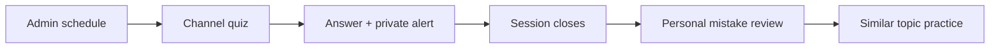
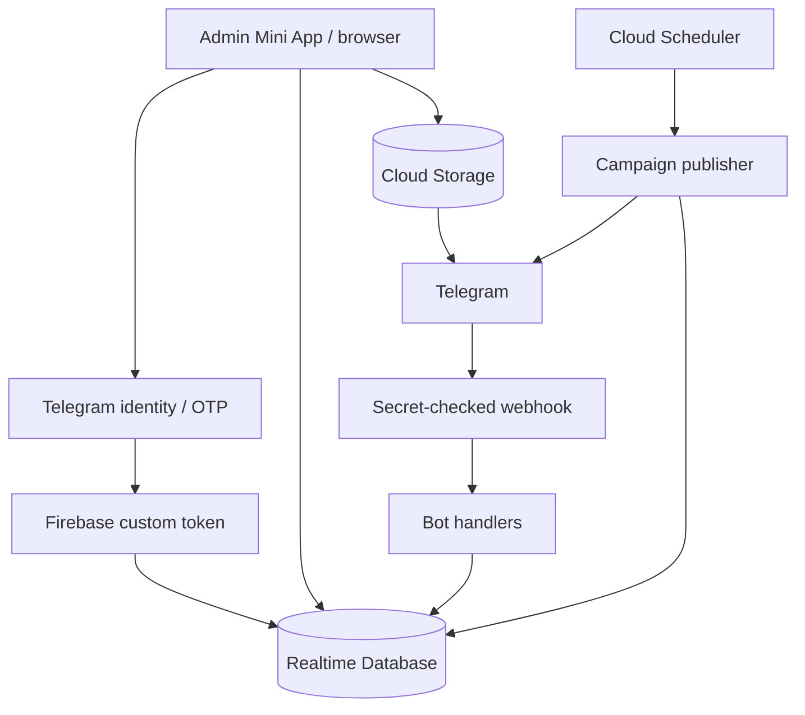

<a id="readme-top"></a>

<p align="center">
  <a href="https://github.com/AQADIL/AkadilEDU-PRIME">
    
  </a>
</p>

<h1 align="center">AkadilEDU PRIME</h1>

<p align="center">
  <strong>Learn here. Prove yourself anywhere.</strong>
</p>

**A Telegram learning loop for UNT mathematics: answer in the channel, understand your mistakes, practise what you need.**

Daily quizzes, personal review and topic practice connect to one question bank. Administrators manage the content and schedule through a browser or Telegram Mini App.

<p align="center"><a href="#the-learning-experience">Student experience</a> · <a href="#technologies">Technologies</a> · <a href="#deployment-and-first-run-setup">Getting started</a> · <a href="#akadiledu-ecosystem">Ecosystem</a> · <a href="SECURITY.md">Security</a> · <a href="LICENSE">Licence</a></p>

> **Intellectual property - all rights reserved.** Copyright © 2026 Akadil Alish. The original source code, documentation and brand assets are proprietary. Use, copying, modification, redistribution and deployment require prior written permission, subject to the exceptions and preserved rights in [LICENSE](LICENSE). Public repository visibility does not grant a reuse licence.

## Explore this guide

<details>
<summary><strong>Open the section navigator</strong></summary>

- [Start here](#start-here)
- [AkadilEDU ecosystem](#akadiledu-ecosystem)
- [The learning experience](#the-learning-experience)
- [Three connected workspaces](#three-connected-workspaces)
- [Content that students can read](#content-that-students-can-read)
- [Technologies](#technologies)
- [Architecture](#architecture)
- [Repository map](#repository-map)
- [Authorized development](#authorized-development)
- [Deployment and first-run setup](#deployment-and-first-run-setup)
- [Spending and recovery](#spending-and-recovery)
- [Operational checks](#operational-checks)
- [Questions before you start](#questions-before-you-start)
- [Ownership](#ownership)

</details>

## Start here

| Your goal | Go directly to | What to expect |
| --- | --- | --- |
| Understand the learner experience | [Quizzes and personal review](#the-learning-experience) | Channel answers, explanations and follow-up practice |
| Manage questions or a campaign | Open the administrator menu in the Telegram bot | Administrator access through verified Telegram identity |
| Set up an authorised environment | [Setup guide](#deployment-and-first-run-setup) | Configuration, secrets, deployment and channel connection |
| Inspect the implementation | [Architecture](#architecture) | Expand the technical section for data flow and identity |

## AkadilEDU ecosystem

<table align="center">
<tr>
<td width="1000" align="center">

<p align="center">
  <strong>AkadilEDU</strong> is the parent learning brand. <strong>AkadilEDU PRIME</strong> is its Telegram practice sub-brand.<br>
  Select a logo or product name to move between the two guides.
</p>

<p align="center">
  <a href="https://github.com/AQADIL/AkadilEDU/blob/main/README.product.md">
    <br>
    <strong>AkadilEDU</strong>
  </a><br>
  <sub>PARENT BRAND · WEB/PWA</sub><br>
  Courses, video lessons and exam preparation.<br>
  <a href="https://github.com/AQADIL/AkadilEDU/blob/main/README.product.md">Open the AkadilEDU guide →</a>
</p>

<p align="center">
  <strong>↓</strong><br>
  <sub>Telegram practice sub-brand</sub>
</p>

<p align="center">
  <a href="https://github.com/AQADIL/AkadilEDU-PRIME/blob/main/README.product.md">
    <br>
    <strong>AkadilEDU PRIME</strong>
  </a><br>
  <sub>TELEGRAM PRACTICE</sub><br>
  Channel quizzes, mistake review and focused topic practice.<br>
  <strong>Current guide</strong>
</p>

</td>
</tr>
</table>

The brand relationship connects the product family. The two applications currently keep separate learner records; verified account linking and shared progress remain planned integrations.

## The learning experience

### Answer where the quiz happens

Scheduled questions arrive in a Telegram channel. Students answer with inline buttons and receive a private correct/incorrect alert without leaving the channel. Each question accepts one recorded answer per student.

### Turn mistakes into practice

When the session ends, its closing message links to a personal review in the bot. Students can inspect their answers, read explanations and practise similar published questions from the same topics. Random practice, topic navigation, statistics and language switching are also available in the private chat.

### Keep the schedule in your hands

The admin workspace controls the destination channel, language, time zone, start time, question count, intervals and final answer window. It checks the bot's channel posting permissions before enabling a campaign. Questions, topic hierarchies and users have dedicated management pages.



## Connected workspaces

| Workspace | Purpose | Implementation |
| --- | --- | --- |
| **Telegram bot** | Channel answers, personal review, practice and statistics | Node.js, grammY, Firebase Admin SDK |
| **Admin Mini App** | Questions, topics, users and campaign configuration | React 19, Vite, Tailwind CSS, Framer Motion |

The bot and question content support **Kazakh (`kk`), Russian (`ru`) and English (`en`)**. Bot interface translations live in [`bot/i18n.js`](bot/i18n.js). The admin interface is in English.

## Question content

Questions support equivalent Kazakh, Russian and English statements, four answer choices, a hint and an explanation. Question images can display formulas or geometric figures; language-independent visuals can be shared across translations. Answer options, hints and explanations use plain text.

The topic tree identifies final topics with `isLast === true`; the `RANDOM` node is reserved for mixed practice. These are practice materials, not official National Testing Center exam questions.

## Technologies

<details>
<summary><strong>View the technology stack and implementation roles</strong></summary>

| Layer | Technology | Purpose |
| --- | --- | --- |
| Telegram bot | Node.js 22, JavaScript, grammY | Commands, inline answers, personal review and topic practice |
| Admin interface | React 19, React Router, Vite | Browser and Telegram Mini App administration |
| Styling and interaction | Tailwind CSS, Framer Motion, Lucide | Responsive layouts, animations and icons |
| Server and scheduling | Cloud Functions, Cloud Scheduler | Webhook handling, identity verification and timed quiz publication |
| Data and hosting | Firebase | Realtime Database, Authentication, Cloud Storage and Hosting |

Exact dependency declarations: [bot](bot/package.json) · [functions](functions/package.json) · [admin app](admin-mini-app/package.json). Each component has a lockfile recording resolved versions.

</details>

## Architecture

<details>
<summary><strong>Architecture, data services and administrator identity</strong></summary>



**Realtime Database is the source of truth.** It stores topics, questions, campaigns, publications and attempts. Cloud Storage holds question images. Firebase Authentication identifies administrators; Cloud Functions handle privileged authentication, webhook delivery and scheduled publication. Hosting serves the admin application.

### Access and identity

- Telegram Mini App sign-in verifies signed `initData` on the server.
- Browser sign-in sends a four-digit code to the administrator's Telegram bot chat. Codes are stored as HMACs, expire and have bounded verification attempts.
- The browser request has a cryptographic challenge; successful verification consumes it atomically.
- **Stay logged in** uses Firebase Auth browser persistence. A saved preference alone never grants administrator privileges; membership is checked against `/admins`.
- Realtime Database access requires both an administrator claim and an administrator record. Storage rules allow public delivery of question images; private credentials stay server-side.

See [SECURITY.md](SECURITY.md) for private reporting and responsible investigation.

</details>

## Repository map

<details>
<summary><strong>Browse source directories and configuration files</strong></summary>

| Path | Contents |
| --- | --- |
| [`bot/`](bot/) | Telegram handlers, localization, question selection and channel scheduling |
| [`functions/`](functions/) | Webhook, identity exchange, browser OTP and scheduled campaigns |
| [`admin-mini-app/`](admin-mini-app/) | React administration interface |
| [`scripts/`](scripts/) | First-administrator bootstrap |
| [`assets/brand/prime-transparent.png`](assets/brand/prime-transparent.png) | AkadilEDU PRIME logo with a transparent background |
| [`database.rules.json`](database.rules.json), [`storage.rules`](storage.rules) | Client access rules |
| [`firebase.json`](firebase.json) | Functions preparation and Hosting configuration |

</details>

## Authorized development

<details>
<summary><strong>Installation, environment templates and useful commands</strong></summary>

Use these steps only with the owner's permission and your own authorized service configuration. There are no default administrator credentials or bundled production datasets.

**Requirements:** Node.js 22.12 or newer in the Node.js 22 line, npm, a configured Firebase project and a Telegram bot.

```powershell
npm ci
npm --prefix bot ci
npm --prefix functions ci
npm --prefix admin-mini-app ci
```

Copy the relevant `.env.example` files to local `.env` files and fill in the real values. The deployment section below covers authentication, secrets, administrator setup and deployment order.

| Configuration template | Scope |
| --- | --- |
| [`.env.example`](.env.example) | Local bot, Firebase credentials, webhook and bootstrap |
| [`functions/.env.example`](functions/.env.example) | Deployed function configuration and OTP limits |
| [`admin-mini-app/.env.example`](admin-mini-app/.env.example) | Public browser Firebase configuration |

Secrets for deployed functions belong in Secret Manager. Private API keys, bot tokens and service-account credentials must never appear in `VITE_*` values. Local environment files, credential files and generated deployment bundles are excluded from Git.

### Useful commands

| Command | Purpose |
| --- | --- |
| `npm --prefix admin-mini-app run dev` | Start the admin development server |
| `npm --prefix admin-mini-app run lint` | Lint the admin application |
| `npm --prefix admin-mini-app run build` | Produce the admin Hosting bundle |
| `npm --prefix bot start` | Run local Telegram polling, without an active webhook |
| `npm --prefix functions run prepare:bot` | Package the current bot source for Functions |

Root tooling provides `npm run check` for source checks, the admin build and Firebase access-rule tests. Install the root and component dependencies first; rule tests require Java 21 or newer. Dependency versions are pinned in each lockfile.

</details>

### Deployment and first-run setup

<details>
<summary><strong>Configure services, bootstrap access and deploy</strong></summary>

#### Configuration

- Set the actual bot identity, HTTPS deep-link base, Mini App address and Firebase project values.
- For local Firebase Admin access, set `GOOGLE_APPLICATION_CREDENTIALS` to a credential file outside version control, or configure Application Default Credentials. Deployed Functions use the runtime identity.
- In Functions, use `RTDB_URL` and `DEPLOY_REGION`. The browser's `VITE_FIREBASE_FUNCTIONS_REGION` must match the deployed region.
- Set `SCHEDULER_CRON` to check campaigns every minute. Individual campaign times and time zones are managed in the admin interface.
- Set all authentication lifetime and rate-limit values listed in the templates. Browser OTP attempts are bounded by `BROWSER_AUTH_OTP_MAX_ATTEMPTS`.

#### Prepare Firebase identity and secrets

Initialize Firebase Authentication for custom-token sign-in and authorize the admin application's domains. Administrator access uses Telegram identity; email or anonymous sign-in is not required.

For deployed Functions, set the following secrets in the intended project:

```powershell
firebase functions:secrets:set BOT_TOKEN --project $env:FIREBASE_PROJECT_ID
firebase functions:secrets:set TELEGRAM_WEBHOOK_SECRET --project $env:FIREBASE_PROJECT_ID
firebase functions:secrets:set BROWSER_AUTH_OTP_PEPPER --project $env:FIREBASE_PROJECT_ID
```

Use a random OTP pepper containing at least 32 bytes of entropy. Keep these secrets out of `functions/.env`. The local bot's root `.env` needs matching webhook and OTP secrets when those features are used.

The deployed runtime identity must be able to sign Firebase custom tokens. Configure the required `iam.serviceAccounts.signBlob` permission, using `roles/iam.serviceAccountTokenCreator` on its own service account where appropriate for the selected deployment identity.

#### Bootstrap the first administrator

For a database without administrators, put your Telegram user ID in `ADMIN_BOOTSTRAP_TELEGRAM_ID` and run:

```powershell
node scripts/add-admin.js
```

This privileged script refuses to modify an existing administrator collection. Keep database rules closed; do not grant public write access to bootstrap an account.

#### Check and deploy

```powershell
npm --prefix admin-mini-app run lint
npm --prefix admin-mini-app run build
firebase deploy --only database,storage,functions,hosting --project $env:FIREBASE_PROJECT_ID
```

The Firebase CLI reads the target project ID from the PowerShell environment in these commands; set it explicitly before running them. The Functions predeploy hook packages the current `bot/` source automatically. Build the admin application before deploying: Hosting serves `admin-mini-app/dist` and has no build hook.

#### Connect Telegram

Set the root `.env` value `TELEGRAM_WEBHOOK_URL` to the deployed `telegramWebhook` function, then register it:

```powershell
npm --prefix bot run webhook:register
```

Add the bot to the destination channel as an administrator with posting rights. Open `/admin` in the bot, or sign in through the configured admin browser URL with the Telegram-delivered code. Use **Stay logged in** if persistent browser access is wanted.

#### Enable a real campaign

Create or publish valid questions, then configure the channel, language, time zone, start time and question timing in **Campaigns**. Verify channel permissions and enable the campaign. Without an enabled campaign and suitable published questions, nothing is automatically posted.

For development without an active Telegram webhook, `npm --prefix bot start` uses polling. The admin development server starts with `npm --prefix admin-mini-app run dev`.

</details>

## Continuous integration and delivery

GitHub Actions runs the following gates for pull requests, pushes to `main` and manual workflow runs:

| Gate | Checks |
| --- | --- |
| Source security | Credential patterns, private deployment destinations, JavaScript syntax, JSON/lockfile consistency and documentation links |
| Admin checks | ESLint, a compile build and production dependency audit |
| Backend checks | Bot/Functions installation, deployment packaging and production dependency audits |
| Access rules | Ten Realtime Database/Storage tests in isolated `demo-*` emulators and a tooling dependency audit |

The dependency gates reject high and critical findings in their configured scope. Dependabot proposes weekly updates for the npm manifests and pinned Actions.

After every gate passes on `main`, the production job validates the real deployment configuration, builds the admin application, deploys Firebase services and verifies that Hosting serves the exact build and its assets. Deployments are serialized. Pull requests do not receive production configuration or Google credentials.

Google Workload Identity Federation grants short-lived access restricted to this repository, the production environment, the main branch and the deployment workflow. No service-account private key is stored in GitHub. The release destination is kept in an encrypted secret; no environment URL or preview link is published. Log masking covers the configured origin and Hosting aliases. Source checks use hostname fingerprints to detect accidental links without publishing the addresses.

Deployment configuration is held in GitHub secrets `FIREBASE_WEB_CONFIG`, `FIREBASE_FUNCTIONS_CONFIG` and `FIREBASE_HOSTING_ORIGIN`. Repository variables select the project, deployment identity, identity provider, public Telegram script and private-host fingerprints. Bot, webhook and OTP secrets remain in Google Secret Manager.

## Operational checks

<details>
<summary><strong>Checklist for verifying an authorised Telegram campaign</strong></summary>

Before enabling a real campaign, verify the configured environment with a channel you are authorised to use:

1. Sign in through a genuine Telegram Mini App launch or the Telegram-delivered browser code; verify the account is an administrator.
2. Open the topic tree and check that the intended questions are published and contain valid choices and answers.
3. Configure the channel, language, time zone and schedule; check the bot has posting rights.
4. Observe a real session, answer from a learner account and check that a second answer is not recorded for the same question.
5. Open the closing link and confirm that personal answers, explanations and available topic practice are displayed.

These are operator verification steps, not a claim that every deployment or every question has passed review. Source lint, type checks and builds do not replace a connected Telegram campaign check.

</details>

## Questions before you start

<details>
<summary><strong>Can I reuse or deploy the source code?</strong></summary>

Prior written permission from Akadil Alish is required under [LICENSE](LICENSE). Public visibility does not grant a reuse or deployment licence. Third-party terms and the preserved rights in the licence continue to apply.

</details>

<details>
<summary><strong>Do Web and Telegram already share learner progress?</strong></summary>

The applications currently keep separate learner records. Verified account linking, shared topic progress and student learning plans remain planned product integrations.

</details>

<details>
<summary><strong>Does opening the repository provide a working account?</strong></summary>

Repository access does not grant access to production records, student enrolments or administrator accounts. Use the hosted application with an authorised account, or configure an environment you are permitted to operate using the setup instructions.

</details>

## Ownership

**The original AkadilEDU PRIME source, documentation and brand assets are the intellectual property of Akadil Alish.**

Created and maintained by **[Akadil Alish · AQADIL](https://github.com/AQADIL)**.

AkadilEDU PRIME's original source, documentation and brand assets are proprietary. Personal, educational and commercial reuse all require prior written permission. Third-party dependencies retain their own licenses; platform rights and existing valid grants are preserved under [LICENSE](LICENSE).

<p align="right"><a href="#readme-top">Back to top ↑</a></p>
