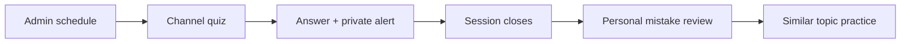
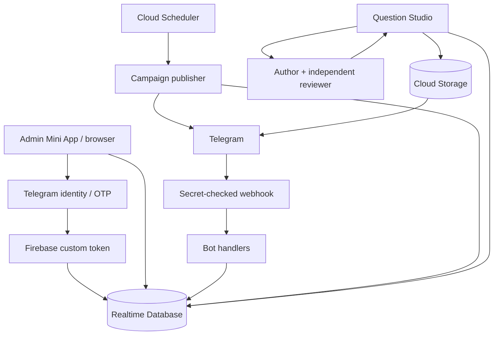

<p align="center">
  <a href="https://github.com/AQADIL/AkadilEDU-PRIME">
    
  </a>
</p>

<h1 align="center">AkadilEDU PRIME</h1>

<p align="center">
  <strong>Learn here. Prove yourself anywhere.</strong>
</p>

**A Telegram learning loop for UNT mathematics: answer in the channel, understand your mistakes, practise what you need.**

Daily quizzes, personal review and topic practice connect to one question bank. Administrators manage the content and schedule through a browser or Telegram Mini App. A separate Question Studio creates, checks and repairs multilingual practice material through the API.

[Admin workspace](https://akadiledu-bot.web.app/) · [Setup](QUICKSTART.md) · [Question Studio](question-studio/README.md) · [Security](SECURITY.md) · [License](LICENSE)

> **Intellectual property - all rights reserved.** Copyright © 2026 Akadil Alish. The original source code, documentation and brand assets are proprietary. Use, copying, modification, redistribution and deployment require prior written permission, subject to the exceptions and preserved rights in [LICENSE](LICENSE). Public repository visibility does not grant a reuse licence.

## AkadilEDU ecosystem

**AkadilEDU** is the parent learning brand. **AkadilEDU PRIME** is its Telegram practice sub-brand. Select a logo or product name to move between the two guides.

<table>
  <tr>
    <td align="center">
      <a href="https://github.com/AQADIL/AkadilEDU/blob/main/README.product.md">
        <br>
        <strong>AkadilEDU</strong>
      </a><br>
      <sub>PARENT BRAND · WEB/PWA</sub><br>
      Courses, video lessons and exam preparation.<br>
      <a href="https://github.com/AQADIL/AkadilEDU/blob/main/README.product.md">Open the AkadilEDU guide →</a>
    </td>
  </tr>
  <tr>
    <td align="center">
      <strong>↓</strong><br>
      <sub>Telegram practice sub-brand</sub>
    </td>
  </tr>
  <tr>
    <td align="center">
      <a href="https://github.com/AQADIL/AkadilEDU-PRIME/blob/main/README.product.md">
        <br>
        <strong>AkadilEDU PRIME</strong>
      </a><br>
      <sub>TELEGRAM PRACTICE</sub><br>
      Channel quizzes, mistake review and focused topic practice.<br>
      <strong>Current guide</strong>
    </td>
  </tr>
</table>

The brand relationship connects the product family. The two applications currently keep separate learner records; verified account linking and shared progress remain planned integrations.

## Explore this guide

[Learning experience](#the-learning-experience) · [Workspaces](#three-connected-workspaces) · [Content quality](#content-that-students-can-read) · [Architecture](#architecture) · [Repository map](#repository-map) · [Development](#authorized-development) · [Recovery](#spending-and-recovery) · [Ecosystem](#akadiledu-ecosystem)

## The learning experience

### Answer where the quiz happens

Scheduled questions arrive in a Telegram channel. Students answer with inline buttons and receive a private correct/incorrect alert without leaving the channel. Each question accepts one recorded answer per student.

### Turn mistakes into practice

When the session ends, its closing message links to a personal review in the bot. Students can inspect their answers, read explanations and practise similar published questions from the same topics. Random practice, topic navigation, statistics and language switching are also available in the private chat.

### Keep the schedule in your hands

The admin workspace controls the destination channel, language, time zone, start time, question count, intervals and final answer window. It checks the bot's channel posting permissions before enabling a campaign. Questions, topic hierarchies and users have dedicated management pages.



## Three connected workspaces

| Workspace | Purpose | Implementation |
| --- | --- | --- |
| **Telegram bot** | Channel answers, personal review, practice and statistics | Node.js, grammY, Firebase Admin SDK |
| **Admin Mini App** | Questions, topics, users and campaign configuration | React 19, Vite, Tailwind CSS, Framer Motion |
| **Question Studio** | API authoring, independent review, correction, previews and costs | TypeScript, Zod, OpenAI API, KaTeX, Playwright, Sharp |

The bot and question content support **Kazakh (`kk`), Russian (`ru`) and English (`en`)**. Bot interface translations live in [`bot/i18n.js`](bot/i18n.js). The admin interface is in English.

## Content that students can read

Every generated question contains three equivalent statements, four answer choices, a hint and an explanation. A separate review request independently solves and checks the work before publication. Rejected questions receive concrete reviewer feedback, enter a bounded repair queue and undergo another review.

- **Readable mathematics.** Dense fractions, compound logarithm bases and other difficult layouts are typeset into statement images.
- **One visual when possible.** Language-independent formulas and geometry share an image; the instruction is translated separately. Separate images are produced only when the visible content needs translation.
- **Compact choices.** Answer options stay on one line and contain at most 64 UTF-16 characters in every language. Options, hints and explanations remain plain text.
- **Traceable publication.** Request IDs, model identities, review findings and correction history are retained. Only accepted content is eligible for publication.
- **Real topic coverage.** Studio reads the live topic tree, selects exact `isLast === true` leaves and excludes the `RANDOM` service node. Targets vary by topic; difficulty planning aims approximately at 25% easy, 45% medium and 30% hard.

AI review reduces errors; it does not certify mathematical correctness. These are original practice materials, not official National Testing Center exam questions.

## Architecture

<details>
<summary><strong>Architecture, data services and administrator identity</strong></summary>



**Realtime Database is the source of truth.** It stores topics, questions, campaigns, publications and attempts. Cloud Storage holds question images. Firebase Authentication identifies administrators; Cloud Functions handle privileged authentication, webhook delivery and scheduled publication. Hosting serves the admin application.

Question Studio has two execution modes: a local Node.js worker and a separate [Google Apps Script worker](question-studio/cloud/README.md). Apps Script uses resumable timed steps and has daily runtime quotas. One authoritative worker owns a run at a time.

### Access and identity

- Telegram Mini App sign-in verifies signed `initData` on the server.
- Browser sign-in sends a four-digit code to the administrator's Telegram bot chat. Codes are stored as HMACs, expire and have bounded verification attempts.
- The browser request has a cryptographic challenge; successful verification consumes it atomically.
- **Stay logged in** uses Firebase Auth browser persistence. A saved preference alone never grants administrator privileges; membership is checked against `/admins`.
- Realtime Database access requires both an administrator claim and an administrator record. Storage rules allow public delivery of question images; private credentials stay server-side.

See [SECURITY.md](SECURITY.md) for private reporting and responsible investigation.

</details>

## Repository map

<details>
<summary><strong>Browse source directories and configuration files</strong></summary>

| Path | Contents |
| --- | --- |
| [`bot/`](bot/) | Telegram handlers, localization, question selection and channel scheduling |
| [`functions/`](functions/) | Webhook, identity exchange, browser OTP and scheduled campaigns |
| [`admin-mini-app/`](admin-mini-app/) | React administration interface |
| [`question-studio/`](question-studio/) | Authoring/review pipeline, renderer and local browser workspace |
| [`question-studio/cloud/`](question-studio/cloud/) | Apps Script worker, private UI and deployment tooling |
| [`scripts/`](scripts/) | First-administrator bootstrap |
| [`assets/brand/prime-transparent.png`](assets/brand/prime-transparent.png) | AkadilEDU PRIME logo with a transparent background |
| [`database.rules.json`](database.rules.json), [`storage.rules`](storage.rules) | Client access rules |
| [`firebase.json`](firebase.json) | Functions preparation and Hosting configuration |

</details>

## Authorized development

<details>
<summary><strong>Installation, environment templates and useful commands</strong></summary>

Use these steps only with the owner's permission and your own authorized service configuration. There are no default administrator credentials or bundled production datasets.

**Requirements:** Node.js 22.12 or newer in the Node.js 22 line, npm, a configured Firebase project and a Telegram bot. Studio additionally requires an API account and a supported local browser.

```powershell
npm --prefix bot ci
npm --prefix functions ci
npm --prefix admin-mini-app ci
npm --prefix question-studio ci
```

Copy the relevant `.env.example` files to local `.env` files and fill in the real values. [QUICKSTART.md](QUICKSTART.md) covers authentication, secrets, administrator setup and deployment order.

| Configuration template | Scope |
| --- | --- |
| [`.env.example`](.env.example) | Local bot, Firebase credentials, webhook and bootstrap |
| [`functions/.env.example`](functions/.env.example) | Deployed function configuration and OTP limits |
| [`admin-mini-app/.env.example`](admin-mini-app/.env.example) | Public browser Firebase configuration |
| [`question-studio/.env.example`](question-studio/.env.example) | Models, prices, API budget, rendering and worker ownership |

Secrets for deployed functions belong in Secret Manager. Private API keys, bot tokens and service-account credentials must never appear in `VITE_*` values. Local environment files, Studio state, credential files and generated deployment bundles are excluded from Git.

### Useful commands

| Command | Purpose |
| --- | --- |
| `npm --prefix admin-mini-app run dev` | Start the admin development server |
| `npm --prefix admin-mini-app run lint` | Lint the admin application |
| `npm --prefix admin-mini-app run build` | Produce the admin Hosting bundle |
| `npm --prefix bot start` | Run local Telegram polling, without an active webhook |
| `npm --prefix functions run prepare:bot` | Package the current bot source for Functions |
| `npm --prefix question-studio run check` | Type-check the local Studio |
| `npm --prefix question-studio run cloud:check` | Type-check the Apps Script worker |
| `npm --prefix question-studio start` | Start Studio at its configured loopback origin |

There is no root npm workspace or combined root check command. Dependency versions are pinned in each component's lockfile.

</details>

## Spending and recovery

<details>
<summary><strong>Content-tool budgets, worker limits and recovery behaviour</strong></summary>

Studio persists a conservative reservation **before** every paid API request. Authoring, reviews, research and repairs share one run budget, with a configured maximum of **$50**. Recorded usage replaces settled reservations; uncertain charges retain their full reserve. New work is admitted only when its maximum reserved cost fits the remaining budget.

Local generation supports up to 16 concurrent jobs with serialized budget admission. Known response IDs are retrieved again after connection failures. Terminal responses without usage are isolated with their reserve intact, allowing other work to continue. Content corrections and retries are bounded; authentication or inconsistent accounting can still require intervention.

The API limit belongs to this Studio run. It is not an account-wide cap and does not cover Firebase charges. Apps Script runtime quotas and provider rate limits remain separate. See [Studio operations](question-studio/README.md#costs-and-recovery) for the complete behavior.

</details>

## Operational checks

<details>
<summary><strong>Checklist for verifying an authorised Telegram campaign</strong></summary>

Before enabling a real campaign, verify the configured environment with a channel you are authorised to use:

1. Sign in through a genuine Telegram Mini App launch or the Telegram-delivered browser code; verify the account is an administrator.
2. Open the topic tree and check that the intended questions are published and contain valid choices and answers.
3. Configure the channel, language, time zone and schedule; check the bot has posting rights.
4. Observe a real session, answer from a learner account and check that a second answer is not recorded for the same question.
5. Open the closing link and confirm that personal answers, explanations and available topic practice are displayed.

These are operator verification steps, not a claim that every deployment or every question has passed review. Source lint, type checks and builds do not replace a connected Telegram campaign check.

</details>

## Ownership

**The original AkadilEDU PRIME source, documentation and brand assets are the intellectual property of Akadil Alish.**

Created and maintained by **[Akadil Alish · AQADIL](https://github.com/AQADIL)**.

AkadilEDU PRIME's original source, documentation and brand assets are proprietary. Personal, educational and commercial reuse all require prior written permission. Third-party dependencies retain their own licenses; platform rights and existing valid grants are preserved under [LICENSE](LICENSE).
